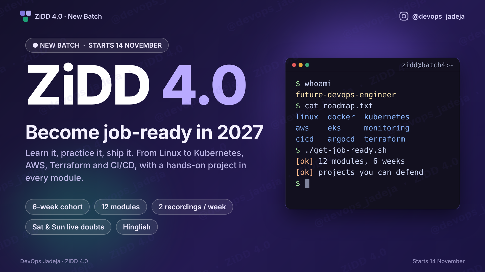
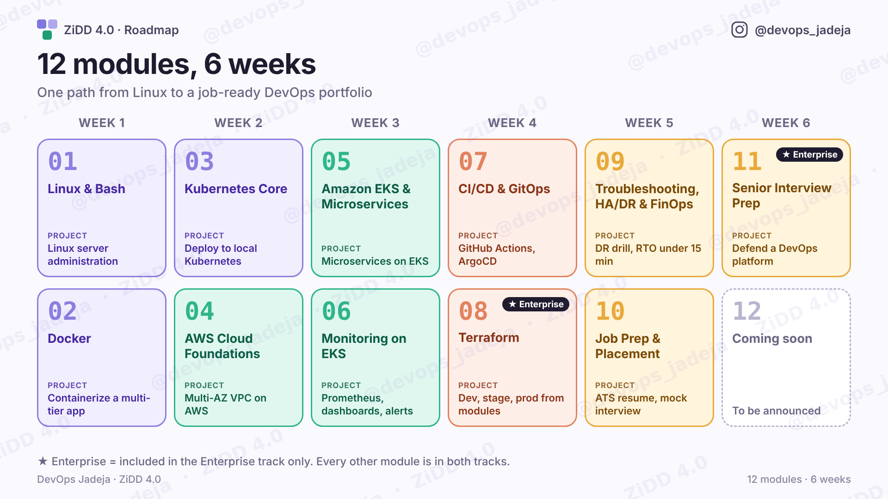

<p align="center">
  
</p>

# ZiDD 4.0 · Course Repository

Welcome to the ZiDD 4.0 batch with **DevOps Jadeja** (Instagram: [@devops_jadeja](https://www.instagram.com/devops_jadeja/)).

This repo is your home base for the next six weeks. Every module has its own folder with a README that tells you **what to watch, what to build and what to practice**. You learn it, you practice it, and you finish with projects you can explain in an interview.



---

## 🗺️ The 12 modules

| # | Module | Week | Track | Project | Status |
|---|--------|------|-------|---------|--------|
| 01 | [Linux & Bash Foundations](modules/01-linux-bash/) | 1 | Both | Linux server administration | ✅ Ready |
| 02 | [Docker: Containers from Scratch](modules/02-docker/) | 1 | Both | Containerize a multi-tier app | ✅ Ready |
| 03 | [Kubernetes Core](modules/03-kubernetes-core/) | 2 | Both | Deploy to local Kubernetes | ✅ Ready |
| 04 | [AWS Cloud Foundations](modules/04-aws-cloud-foundations/) | 2 | Both | Multi-AZ VPC on AWS | 🚧 Coming soon |
| 05 | [Amazon EKS & Microservices](modules/05-eks-microservices/) | 3 | Both | Microservices on EKS | 🚧 Coming soon |
| 06 | [Monitoring on EKS](modules/06-monitoring-on-eks/) | 3 | Both | Monitoring on EKS | 🚧 Coming soon |
| 07 | [CI/CD Pipelines & GitOps](modules/07-cicd-gitops/) | 4 | Both (ArgoCD in Enterprise) | CI/CD & GitOps pipeline | 🚧 Coming soon |
| 08 | [Terraform for Enterprise](modules/08-terraform/) | 4 | ★ Enterprise | Dev, stage and prod from the same modules | 🚧 Coming soon |
| 09 | [Troubleshooting, HA/DR & FinOps](modules/09-troubleshooting-ha-dr-finops/) | 5 | Both | Troubleshooting, HA/DR & FinOps | 🚧 Coming soon |
| 10 | [Job Preparation & Placement](modules/10-job-prep-placement/) | 5 | Both | Job preparation & placement | 🚧 Coming soon |
| 11 | [Senior DevOps Interview Preparation](modules/11-senior-interview-prep/) | 6 | ★ Enterprise | Senior interview prep | 🚧 Coming soon |
| 12 | [To be announced](modules/12-coming-soon/) | 6 | To be announced | To be announced | 🚧 Coming soon |

★ **Enterprise** = included in the Enterprise track only. Every other module is in both tracks.

---

## 🔁 How every module works

1. **Watch** the recording for the module. The link is at the top of the module README.
2. **Practice** the hands-on tasks. Type the commands yourself, don't just read them.
3. **Check yourself** with the interview questions at the bottom of the module.
4. **Bring your doubts** to the live doubt session on Saturday or Sunday.

Each week you get **2 recordings**, plus live doubt sessions every **Saturday and Sunday**. Complex topics are also taught live.

---

## 📁 What is in this repo

```
zidd-4.0/
├── README.md                  ← you are here
├── LICENSE                    ← how you may (and may not) use this material
├── images/                    ← banner and roadmap
└── modules/
    ├── 01-linux-bash/
    │   ├── README.md          ← video, topics, tasks, interview questions
    │   └── images/
    ├── 02-docker/
    │   ├── README.md          ← recording, tasks, Project #02, 10 interview questions
    │   └── images/
    ├── 03-kubernetes-core/
    │   ├── README.md          ← recording, topics, Task 1, 10 interview questions
    │   └── images/
    ├── ...                    ← one folder per module
    └── 12-coming-soon/
        └── README.md
```

New modules are added here as the weeks go on. Run `git pull` to get the latest.

---

## 🚀 Start here

Three modules are ready. Do them in this order:

| Step | Module | What to do |
|---|---|---|
| 1 | 👉 **[Module 01: Linux & Bash Foundations](modules/01-linux-bash/README.md)** | Watch the Linux recording, then work through the three tasks. |
| 2 | 👉 **[Module 02: Docker: Containers from Scratch](modules/02-docker/README.md)** | Watch the Docker recording, clone the [workshop code](https://github.com/jadeja-rajpal/docker-zidd3), do the three tasks, then build **Project #02: Containerize a Multi-Tier App**. |
| 3 | 👉 **[Module 03: Kubernetes Core](modules/03-kubernetes-core/README.md)** | Watch the Kubernetes recording, clone the [manifests repo](https://github.com/jadeja-rajpal/kubernetes-zidd3), then do **Task 1**: a kind cluster with a frontend and backend talking over a ClusterIP Service. |

> Practice on your own VM, WSL2 or a cloud instance. **Never practice on a production server.**

---

<p align="center"><sub>© 2026 <b>DevOps Jadeja</b> (<a href="https://www.instagram.com/devops_jadeja/">@devops_jadeja</a>) · ZiDD 4.0<br>All content, images and code in this repo are for enrolled ZiDD 4.0 students only. Do not copy, resell or republish without written permission. See <a href="LICENSE">LICENSE</a>.</sub></p>
