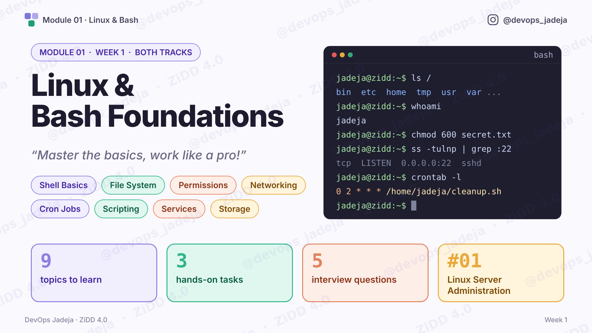
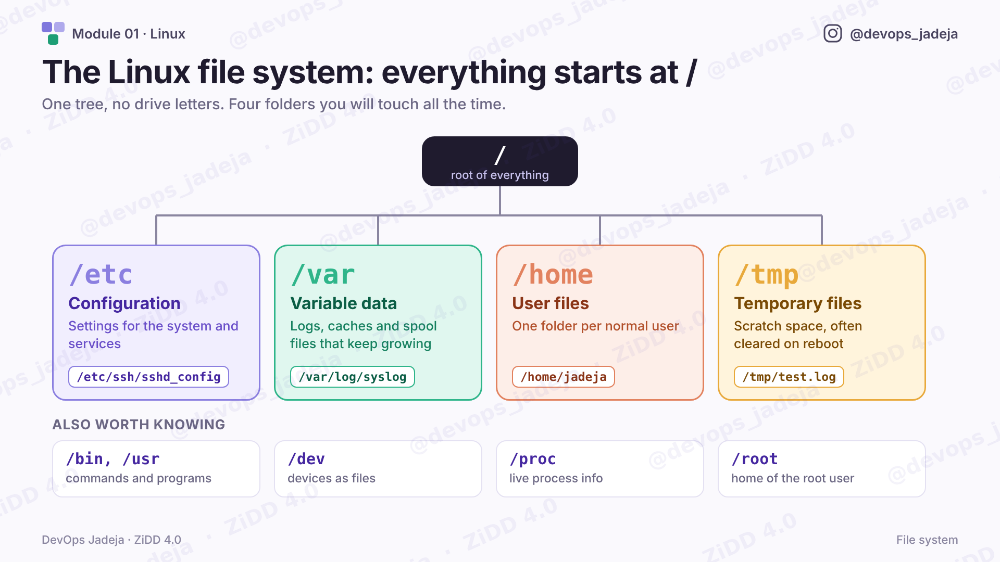
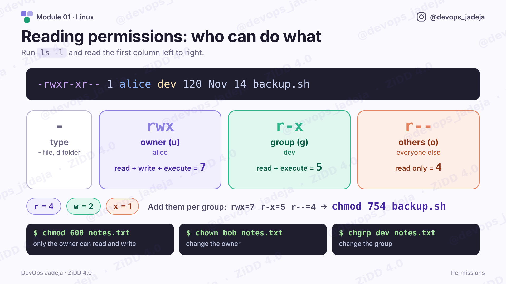
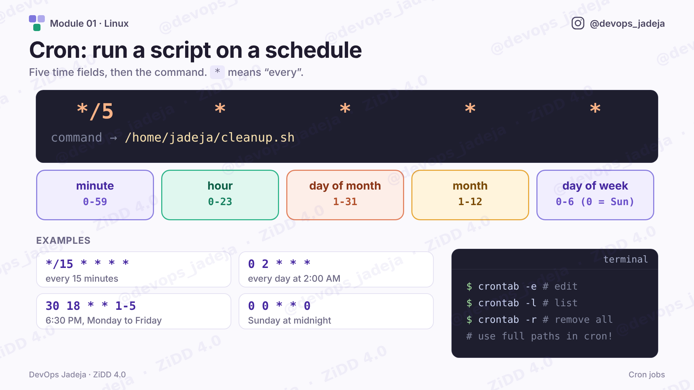
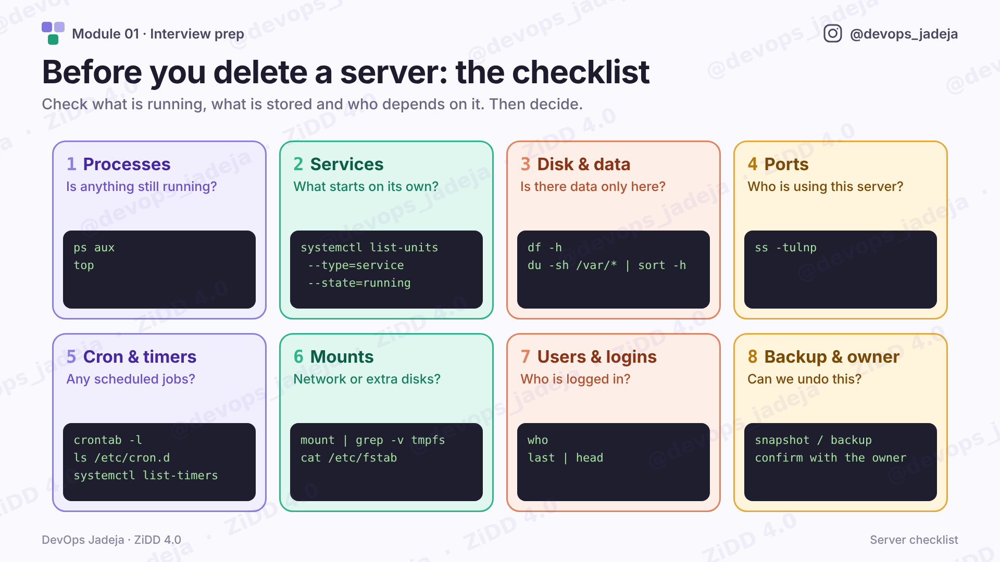

<p align="center">
  
</p>

# Module 01 · Linux & Bash Foundations

> *"Master the basics, work like a pro!"*

| | |
|---|---|
| **Week** | 1 |
| **Track** | Both tracks |
| **Tools** | Linux, Bash |
| **Project** | #01 Linux Server Administration |
| **Interview prep** | 20 hands-on Linux questions (the first 5 are below) |

Almost every server, container and cloud machine you will touch as a DevOps engineer runs Linux. This module gives you the command-line skills the rest of the course builds on.

---

## Step 1 · Watch the recording

Watch the full Linux session first. Keep a terminal open next to the video and type along.

[](https://youtu.be/TjnC_Qrd5_M?si=she17VE-f6Jr3jPP)

▶️ **[youtu.be/TjnC_Qrd5_M](https://youtu.be/UlenpMKWSRk?si=sE75wNgSUXjehM9K)**

### What you will learn

Tick these off as you go.

- [ ] Linux architecture and the file-system hierarchy (`/`, `/etc`, `/var`, `/home`, `/tmp`)
- [ ] Users, groups, `sudo`, and permissions with `chmod`, `chown` and `chgrp`
- [ ] Processes and services: `ps`, `top`, `kill`, `systemctl` and `journalctl`
- [ ] File navigation and text processing: `grep`, `sort`, `awk`, `sed`, pipes and redirection
- [ ] Disks, network disks and package management with `apt`, `yum` and `dnf`
- [ ] SSH, `ssh-keygen` key pairs and file transfer with `scp`
- [ ] Networking basics: IP, DNS, ports, `ping`, `curl`, `ss` and `dig`
- [ ] Cron jobs for scheduled tasks
- [ ] Bash variables, conditions, loops, functions and exit codes

**Key concepts at a glance:** Shell Basics · File System · Permissions · Networking · Cron Jobs · Scripting · Services · Storage

---

## 🖼️ Visual cheat sheets

Keep these open while you practice.

### 1. The file system: everything starts at `/`


### 2. Reading permissions


### 3. Cron: run a script on a schedule


---

## 🛠️ Step 2 · Hands-on tasks

Do these on a machine you can break: an **Ubuntu VM**, a **cloud instance**, or **WSL2** on Windows.

> **Never practice on a production server.** macOS works differently (no `useradd`, no `systemctl`), so use a VM or a cloud instance there.
>
> **WSL2 tip:** cron does not start by itself. Run `sudo service cron start` first (Task 2 needs it).

Type every command yourself. When a command fails, read the error message. It usually tells you the answer.

---

### Task 1 · Two users, one file, different rights

**The goal:** create two users and control exactly who can read and write one user's file.

**Part A.** Create two users, `alice` and `bob`. Make a shared folder owned by `alice`. Alice creates a file in it. **Bob must not be able to write to Alice's file.**

**Part B.** Change the permissions so Bob **cannot even read** the file.

**Part C (bonus).** Create a group called `team` and add both users. Now let `team` **read** the file, while only Alice can still **write** to it.

<details>
<summary>💡 Hints (try first, then open)</summary>

Create the users and the folder:
```bash
sudo useradd -m -s /bin/bash alice
sudo useradd -m -s /bin/bash bob
sudo mkdir /opt/shared
sudo chown alice /opt/shared
```
Run a command *as* another user without logging in:
```bash
sudo -u alice bash -c 'echo "alice private notes" > /opt/shared/report.txt'
sudo -u bob cat /opt/shared/report.txt
```
The tools you need: `ls -l`, `chmod`, `chown`, `chgrp`, `groupadd`, `usermod -aG`, `id`.

**Why not use Alice's home folder?** On Ubuntu a home folder is usually closed to other users (`drwxr-x---`). Bob would get *Permission denied* from the folder, and you would never test the **file's** permissions. Check it with `ls -ld /home/alice`.
</details>

**Check your work**

| Test | Command | Expected |
|---|---|---|
| A: Bob can't write | `sudo -u bob bash -c 'echo hi >> /opt/shared/report.txt'` | `Permission denied` |
| B: Bob can't read | `sudo -u bob cat /opt/shared/report.txt` | `Permission denied` |
| C: team can read | `sudo -u bob cat /opt/shared/report.txt` | the file's text |
| C: team can't write | `sudo -u bob bash -c 'echo hi >> /opt/shared/report.txt'` | `Permission denied` |

Run `ls -l /opt/shared/report.txt` at each stage. At the end you should see something like `-rw-r----- 1 alice team ... report.txt`. Can you explain every character?

**Think about it:** Bob cannot write to the file. Can Bob still *delete* it? What decides that? (Test it, then look at the permissions of the **folder**.)

---

### Task 2 · Delete files automatically with cron

**The goal:** write a script that deletes **one type of file** (one extension) from **one folder**, and run it on a schedule with cron.

**Requirements**
1. A folder `~/cleanup-lab` with files of different types (`.tmp`, `.log`, `.txt`).
2. A script `~/cleanup.sh` that deletes only the `.tmp` files in that folder. It must **leave every other file alone**, and must not go into sub-folders.
3. The folder, extension and log path are **variables** at the top of the script.
4. Every run adds one line to `~/cleanup.log` with the date, how many files were deleted, and the folder.
5. A cron job that runs it. First **every minute** (so you can watch it work), then change it to **every night at 2 AM**.

<details>
<summary>💡 Hints (try first, then open)</summary>

Starter skeleton:
```bash
#!/usr/bin/env bash
# cleanup.sh: delete files of ONE extension from ONE folder
# ZiDD 4.0 · DevOps Jadeja (@devops_jadeja) · github.com/jadeja-rajpal

TARGET_DIR="$HOME/cleanup-lab"   # the folder to clean
EXT="tmp"                        # the extension to delete
LOG="$HOME/cleanup.log"          # where to write what happened

# TODO 1: count the matching files   (find ... | wc -l)
# TODO 2: delete them                (find ... -delete)
# TODO 3: append one line to $LOG    (date, count, folder)
```
**Always do a dry run first.** Replace `-delete` with `-print` and look at what *would* be deleted:
```bash
find "$HOME/cleanup-lab" -maxdepth 1 -type f -name "*.tmp" -print
```
Make the script runnable: `chmod +x ~/cleanup.sh`.

Cron line for the test (use **full paths**, cron does not know your current folder):
```
* * * * * /home/YOUR_USER/cleanup.sh >> /home/YOUR_USER/cleanup-cron.out 2>&1
```
Edit with `crontab -e`, list with `crontab -l`. If nothing runs, look at the cron log: `grep CRON /var/log/syslog` (Ubuntu) or `journalctl -u cron`.
</details>

**Check your work**
```bash
mkdir -p ~/cleanup-lab
touch ~/cleanup-lab/old1.tmp ~/cleanup-lab/old2.tmp ~/cleanup-lab/keep.log ~/cleanup-lab/notes.txt

# wait for the next minute, then:
ls ~/cleanup-lab        # expected: keep.log  notes.txt   (the .tmp files are gone)
cat ~/cleanup.log       # expected: a new line each minute
```
Then change the schedule to `0 2 * * *` and confirm with `crontab -l`.

**Challenge:** delete only `.tmp` files **older than 7 days** (`-mtime +7`). Test it with `touch -d '10 days ago' file.tmp`.

---

### Task 3 · A server health-check script

**The goal:** write `health-check.sh`, a script that tells you in ten seconds whether a server looks healthy. It is the kind of script you run before and after every change.

**Requirements**
1. Print the **hostname**, the **uptime**, the **disk usage of `/`** and the **memory usage**.
2. Print the **top 3 processes** by memory.
3. Print how many **ports are listening** and how many **systemd services have failed**.
4. Use **functions** (for example `disk_used()` and `mem_used()`) and **variables**.
5. Take an optional **threshold** as the first argument, default `80`.
6. If disk usage is at or above the threshold, print a warning and **exit with code 1**. Otherwise exit with `0`.

<details>
<summary>💡 Hints (try first, then open)</summary>

Building blocks:
```bash
df --output=pcent / | tail -1 | tr -dc '0-9'                  # disk % as a plain number
free -m | awk '/Mem:/ {printf "%.0f", $3/$2*100}'            # memory %
ps -eo pid,comm,%mem --sort=-%mem | head -4                   # header + top 3
ss -tuln | tail -n +2 | wc -l                                 # listening sockets
systemctl --failed --no-legend | wc -l                        # failed services
```
The default threshold: `THRESHOLD="${1:-80}"`.
The test: `if [ "$DISK" -ge "$THRESHOLD" ]; then ... exit 1; fi`.
</details>

**Check your work**
```bash
chmod +x health-check.sh
./health-check.sh        ; echo "exit code: $?"     # normally 0
./health-check.sh 1      ; echo "exit code: $?"     # threshold of 1%, so it must warn and give 1
```
The second run proves your warning path works. Always test the failing path, not just the happy one.

---

### 🎯 Bonus · SSH keys and `scp`

1. Generate a key pair with `ssh-keygen -t ed25519`.
2. Copy the public key to another machine (or to your own machine) with `ssh-copy-id user@host`.
3. Log in with `ssh user@host`. It should **not** ask for a password.
4. Copy a file with `scp notes.txt user@host:/tmp/` and check it arrived.

Which of the two keys must **never** leave your machine?

---

## 🎤 Step 3 · Interview questions

Answer each one **out loud** before you open the hint. Interviewers want to hear how you think and which commands you reach for.

### Q1. What pre-checks do you do before deleting a server?
<details>
<summary>What a good answer covers</summary>



Say it as a list, and name the command for each item:
- **Processes:** `ps aux`, `top`. Is anything still working?
- **Services:** `systemctl list-units --type=service --state=running`. What starts on its own?
- **Disk and data:** `df -h`, `du -sh /var/*`. Is there data that exists **only** on this server?
- **Ports:** `ss -tulnp`. Is anyone still connecting to it?
- **Cron and timers:** `crontab -l`, `/etc/cron.d`, `systemctl list-timers`.
- **Mounts:** `mount`, `/etc/fstab`. Network or extra disks attached?
- **Users and logins:** `who`, `last`. Is someone working on it right now?
- **Backup and owner:** take a snapshot or backup, and **confirm with the owner** before deleting.

The closing line that impresses: *"I make sure I can undo it before I do it."*
</details>

### Q2. A server's disk is 100% full. How do you find out why?
<details>
<summary>What a good answer covers</summary>

1. `df -h` to see which file system is full.
2. `du -sh /* 2>/dev/null | sort -h` and go deeper into the biggest folder. Logs in `/var/log` are a common cause.
3. `df -i` to check **inodes**. You can be out of inodes with free space left (millions of tiny files).
4. `lsof +L1` to find **deleted files still held open** by a process. The space is not freed until the process restarts.
5. Fix: rotate or compress logs, clear caches, expand the disk. Don't just delete random files.
</details>

### Q3. An application on port 8080 is not reachable. Walk me through it.
<details>
<summary>What a good answer covers</summary>

Go from the inside out:
1. Is the service running? `systemctl status myapp`, and the logs: `journalctl -u myapp -e`.
2. Is it listening? `ss -tulnp | grep 8080`. Listening on `127.0.0.1` only, or on `0.0.0.0`?
3. Does it work locally? `curl -i localhost:8080`.
4. Is a firewall blocking it? `ufw status` or `iptables -L`. In the cloud, check the **security group** too.
5. Does DNS point to the right machine? `dig example.com`.
</details>

### Q4. You run `./deploy.sh` and get "Permission denied". Why, and how do you fix it?
<details>
<summary>What a good answer covers</summary>

- The file most likely has **no execute (`x`) bit**. Check with `ls -l deploy.sh`.
- Fix: `chmod +x deploy.sh` (or `chmod 755 deploy.sh`).
- Other causes: the folder is mounted `noexec`, you don't own it and the group or others lack `x`, or the script's first line (`#!/bin/bash`) points to an interpreter that doesn't exist.
- Bonus: explain `755` digit by digit (`7` = rwx for the owner, `5` = r-x for the group, `5` = r-x for others).
</details>

### Q5. Your cron job does not run. How do you debug it?
<details>
<summary>What a good answer covers</summary>

1. Is it really installed? `crontab -l` (for the right user).
2. Is the cron service running? `systemctl status cron` (`crond` on RHEL).
3. Is the schedule correct? Five fields in the right order.
4. Run the **script by hand** with the same user. Does it work?
5. Cron has a **minimal environment**: a short `PATH` and no current folder. Use **full paths** for the script and the commands inside it.
6. Is the script executable (`chmod +x`)? Does it start with `#!/usr/bin/env bash`?
7. Capture the output: `>> /tmp/job.log 2>&1`, then read it. Check the cron log (`grep CRON /var/log/syslog`).
</details>

---

## 📦 Project #01 · Linux Server Administration

> *Administer a Linux server from the command line and automate routine tasks with a script.*

The three tasks above are the building blocks. Put them together on **one server** and you have your project:

| Project part | Built in |
|---|---|
| Users, groups and permissions set up correctly | Task 1 |
| A routine job automated with cron | Task 2 |
| A script that checks the health of the server | Task 3 |
| Remote access with SSH keys | Bonus |

Keep a short notes file with the commands you used and what each one did. In an interview, *"I did this myself and here is exactly how"* beats any theory answer.

---

## 🧰 Command cheat sheet

| Topic | Commands to know |
|---|---|
| Navigation | `pwd`, `ls -la`, `cd`, `mkdir -p`, `cp`, `mv`, `rm` |
| Users and groups | `useradd`, `usermod -aG`, `id`, `groups`, `sudo`, `su` |
| Permissions | `chmod`, `chown`, `chgrp`, `ls -l`, `umask` |
| Processes | `ps aux`, `top`, `kill`, `kill -9` (last resort) |
| Services and logs | `systemctl status/start/stop/enable`, `journalctl -u <svc> -e` |
| Text processing | `grep`, `sort`, `uniq`, `awk`, `sed`, `cut`, `wc`, `\|`, `>`, `>>`, `2>&1` |
| Disks | `df -h`, `du -sh`, `lsblk`, `mount`, `/etc/fstab` |
| Packages | `apt update && apt install`, `yum install`, `dnf install` |
| SSH | `ssh-keygen`, `ssh-copy-id`, `ssh`, `scp` |
| Networking | `ip a`, `ping`, `curl -i`, `ss -tulnp`, `dig` |
| Cron | `crontab -e`, `crontab -l` |
| Bash scripting | `VAR=value`, `if [ ]`, `for`, `while`, `function name() {}`, `$?`, `exit 1` |

---

## ✅ Check yourself

By the end of the week you should be able to:

- [ ] Explain what lives in `/etc`, `/var`, `/home` and `/tmp`
- [ ] Read `-rwxr-xr--` and say who can do what, then write it as a `chmod` number
- [ ] Create a user and control exactly what that user can read and write
- [ ] Find which process is using a port, and stop it
- [ ] Read logs for a service with `journalctl`
- [ ] Schedule a script with cron and debug it when it doesn't run
- [ ] Write a Bash script with variables, a condition and a proper exit code
- [ ] Log in to a server with an SSH key instead of a password

Stuck on something? Write down the command, what you expected and what you got. Bring it to the **Saturday or Sunday live doubt session**.

---

⬅️ [Back to all modules](../../README.md)

---

<p align="center"><sub>© 2026 <b>DevOps Jadeja</b> (<a href="https://www.instagram.com/devops_jadeja/">@devops_jadeja</a>) · ZiDD 4.0<br>All content, images and code in this repo are for enrolled ZiDD 4.0 students only. Do not copy, resell or republish without written permission. See <a href="../../LICENSE">LICENSE</a>.</sub></p>
