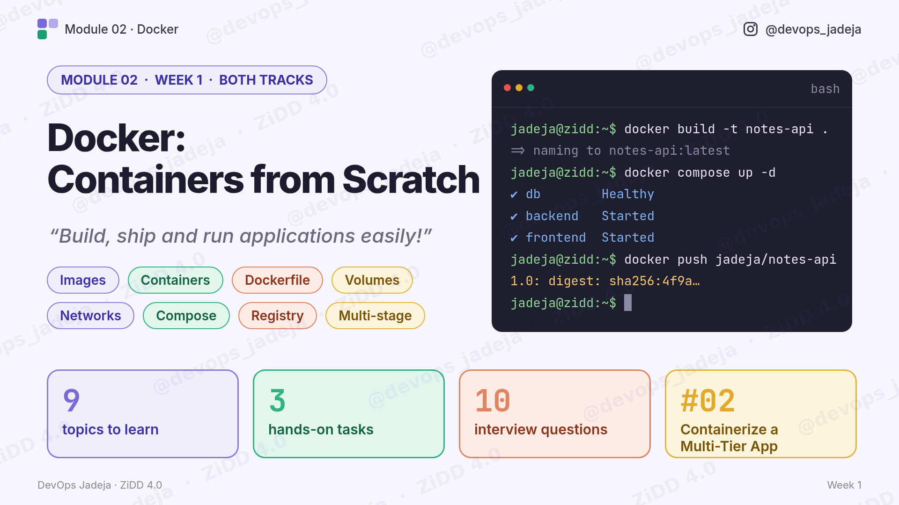
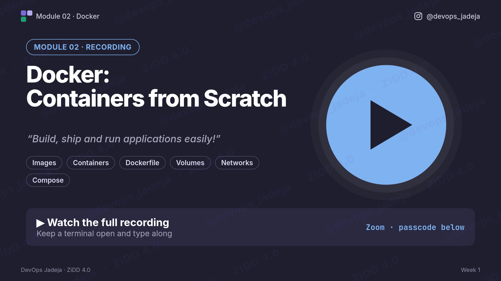
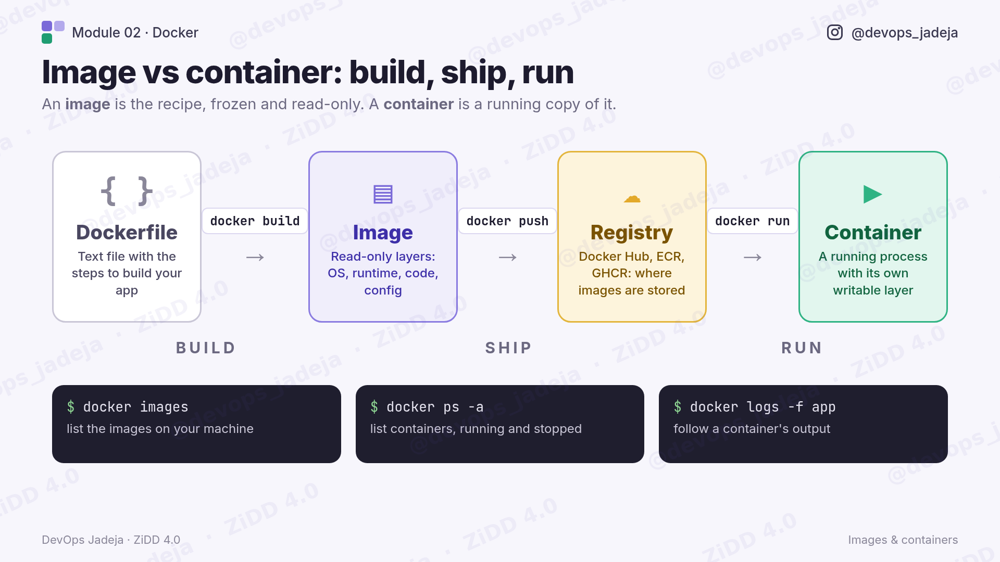
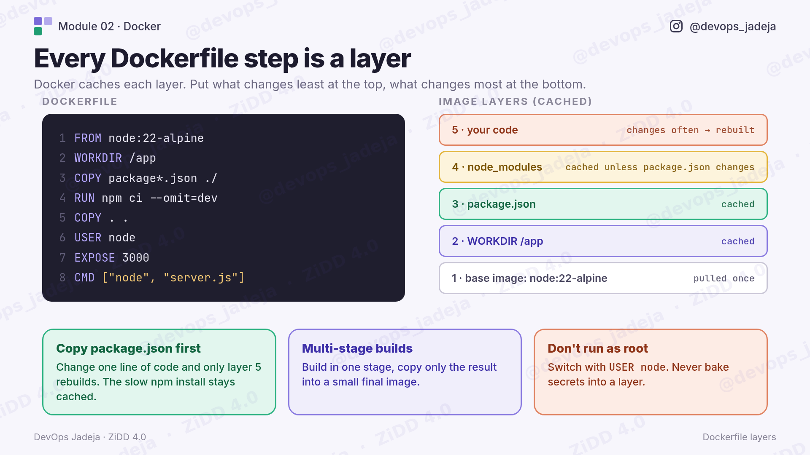
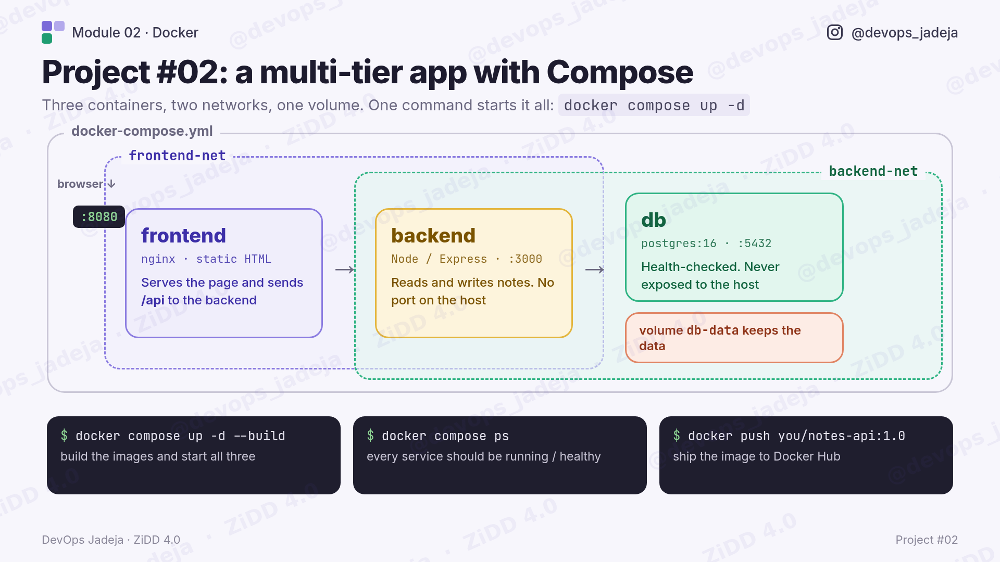

<p align="center">
  
</p>

# Module 02 · Docker: Containers from Scratch

> *"Build, ship and run applications easily!"*

| | |
|---|---|
| **Week** | 1 |
| **Track** | Both tracks |
| **Tools** | Docker, Docker Compose, Docker Hub |
| **Project** | #02 Containerize a Multi-Tier App |
| **Interview prep** | 10 Docker interview questions (below) |

"It works on my machine" stops being an excuse once your app runs in a container. This module teaches you to package an app with everything it needs, run it anywhere, and wire several containers together. Kubernetes in Module 03 builds directly on this.

---

## Step 1 · Watch the recording

Watch the full Docker session first. Keep a terminal open next to the video and type along.

[](https://us06web.zoom.us/rec/share/nux68-rWKdCTIbx-OuKVGlio6aqYEkndWyDhORUDfRmBwrjO_30YrLEFSmF4GxZu.HKVRMdf_tZPjQZb3)

▶️ **[Watch the Docker recording on Zoom](https://us06web.zoom.us/rec/share/nux68-rWKdCTIbx-OuKVGlio6aqYEkndWyDhORUDfRmBwrjO_30YrLEFSmF4GxZu.HKVRMdf_tZPjQZb3)**

🔑 **Passcode:** `W5T%*+DA`

### 📂 Source code used in the video

The code from the recording is in its own repo: **[github.com/jadeja-rajpal/docker-zidd3](https://github.com/jadeja-rajpal/docker-zidd3)**

It is a small Node.js / Express dashboard (port `3000`) with:

| File | What it shows |
|---|---|
| `Dockerfile` | Building an image for a Node.js app |
| `docker-compose.yaml` | nginx + MySQL on one network, with a volume for the database |
| `docker-compose.yaml1` | The dashboard app with a named volume |
| `docker-compose.yaml2` | The dashboard app + Redis, using `depends_on` |
| `server.js`, `public/` | The app itself |

Clone it and follow along with the video:
```bash
git clone https://github.com/jadeja-rajpal/docker-zidd3.git
cd docker-zidd3
```

### What you will learn

Tick these off as you go.

- [ ] Why containers: VMs vs containers, and what problem Docker solves
- [ ] Docker architecture: client, daemon (`dockerd`), images, containers, registry
- [ ] Images vs containers, and the container lifecycle: `run`, `ps`, `stop`, `start`, `rm`
- [ ] Writing a `Dockerfile`: `FROM`, `WORKDIR`, `COPY`, `RUN`, `EXPOSE`, `CMD`
- [ ] Image layers, build cache and `.dockerignore`
- [ ] Port mapping, environment variables, `docker logs` and `docker exec`
- [ ] Volumes and bind mounts: keeping data after a container is deleted
- [ ] Docker networks: containers talking to each other by name
- [ ] Docker Compose for multi-container apps, and pushing images to Docker Hub

**Key concepts at a glance:** Images · Containers · Dockerfile · Volumes · Networks · Compose · Registry · Multi-stage

---

## 🖼️ Visual cheat sheets

Keep these open while you practice.

### 1. Image vs container: build, ship, run


### 2. Every Dockerfile step is a layer


---

## 🛠️ Step 2 · Hands-on tasks

You need Docker installed: **Docker Desktop** on Windows or macOS, or **Docker Engine** on an Ubuntu VM or cloud instance. Check it with:
```bash
docker version
docker run hello-world
```

> **Linux tip:** if every command needs `sudo`, add yourself to the docker group with `sudo usermod -aG docker $USER`, then log out and back in.

Type every command yourself. When a command fails, read the error message. It usually tells you the answer.

---

### Task 1 · Containerize the workshop app

**The goal:** build an image from the workshop repo, run it, look inside it, and clean up.

**Requirements**
1. Clone [docker-zidd3](https://github.com/jadeja-rajpal/docker-zidd3) and build an image called `zidd-dashboard:1.0`.
2. Run it in the background with the name `dashboard`, and map port `3000` on your machine to port `3000` in the container.
3. Open `http://localhost:3000` and call `http://localhost:3000/api/health`.
4. Read its logs, then open a shell **inside** the running container and list the files in `/app`.
5. Add a `.dockerignore` file so `node_modules` and `.git` are **not** copied into the image. Rebuild and compare the image size.
6. Stop and remove the container.

<details>
<summary>💡 Hints (try first, then open)</summary>

```bash
docker build -t zidd-dashboard:1.0 .
docker run -d --name dashboard -p 3000:3000 zidd-dashboard:1.0
docker ps
docker logs -f dashboard              # Ctrl+C to stop following
docker exec -it dashboard sh          # alpine images have sh, not bash
docker images zidd-dashboard          # see the SIZE column
docker stop dashboard && docker rm dashboard
```
A `.dockerignore` works like `.gitignore`:
```
# ZiDD 4.0 · DevOps Jadeja (@devops_jadeja) · github.com/jadeja-rajpal
node_modules
.git
*.log
```
**Why ignore `node_modules`?** The Dockerfile already runs `npm install` inside the image. Copying your local `node_modules` makes the build slower, the image bigger, and can break native packages built for a different OS.
</details>

**Check your work**

| Test | Command | Expected |
|---|---|---|
| Container is running | `docker ps` | `dashboard` with `0.0.0.0:3000->3000/tcp` |
| App answers | `curl localhost:3000/api/health` | JSON with `"status":"UP"` |
| You are inside | `docker exec dashboard ls /app` | `server.js`, `package.json`, `public` ... |
| Cleaned up | `docker ps -a` | no `dashboard` container |

**Think about it:** you ran `docker rm dashboard`. Is the **image** gone too? Run `docker images` and explain the difference.

---

### Task 2 · Volumes and networks

**The goal:** prove that data in a volume survives a deleted container, and that containers on the same network find each other by name.

**Part A: volumes.**
1. Create a volume called `mydata`.
2. Run an `alpine` container that mounts it at `/data` and writes a file into it. Delete the container.
3. Run a **new** container with the same volume and read the file. It must still be there.

**Part B: networks.**
1. Create a network called `zidd-net`.
2. Run an `nginx` container named `web` on that network, **without** publishing any port.
3. From a second container on the same network, reach `web` **by its name**.
4. Try the same from a container that is **not** on `zidd-net`. It should fail.

<details>
<summary>💡 Hints (try first, then open)</summary>

```bash
# Part A
docker volume create mydata
docker run --rm -v mydata:/data alpine sh -c 'echo "hello from zidd" > /data/note.txt'
docker run --rm -v mydata:/data alpine cat /data/note.txt

# Part B
docker network create zidd-net
docker run -d --name web --network zidd-net nginx:alpine
docker run --rm --network zidd-net alpine wget -qO- http://web
docker run --rm alpine wget -qO- -T 3 http://web          # default network: no DNS for "web"
```
Look at what you made: `docker volume inspect mydata`, `docker network inspect zidd-net`.
</details>

**Check your work**

| Test | Expected |
|---|---|
| Read the file from a brand-new container | `hello from zidd` |
| `wget http://web` from inside `zidd-net` | the nginx welcome page HTML |
| `wget http://web` from outside `zidd-net` | `bad address 'web'` |

**Think about it:** why does the name `web` work on `zidd-net` but not on the default `bridge` network?

Clean up: `docker rm -f web`, `docker network rm zidd-net`, `docker volume rm mydata`.

---

### Task 3 · Make the image better, then ship it

**The goal:** improve the workshop `Dockerfile` the way you would in a real team, then push the image to Docker Hub.

**Requirements**
1. Keep the `COPY package*.json` → `RUN npm ...` → `COPY . .` order, so code changes don't reinstall packages. Change one line in `server.js`, rebuild, and watch which steps say `CACHED`.
2. Run the app as the **non-root** `node` user (`USER node`).
3. Add a `HEALTHCHECK` that calls `/api/health`.
4. Tag the image with **your Docker Hub username and a version** (not `latest`), and push it.
5. Delete the image from your machine, then `docker run` it again. Docker should **pull it from Docker Hub**.

<details>
<summary>💡 Hints (try first, then open)</summary>

```dockerfile
# ZiDD 4.0 · DevOps Jadeja (@devops_jadeja) · github.com/jadeja-rajpal
FROM node:22-alpine
WORKDIR /app
COPY package*.json ./
RUN npm ci --omit=dev
COPY . .
USER node
EXPOSE 3000
HEALTHCHECK --interval=15s --timeout=3s --retries=3 \
  CMD wget -qO- http://localhost:3000/api/health || exit 1
CMD ["node", "server.js"]
```
Ship it:
```bash
docker login
docker build -t YOUR_USER/zidd-dashboard:1.0 .
docker push YOUR_USER/zidd-dashboard:1.0
docker rmi YOUR_USER/zidd-dashboard:1.0
docker run -d -p 3000:3000 YOUR_USER/zidd-dashboard:1.0     # watch it pull
```
</details>

**Check your work**
```bash
docker exec <container> whoami         # expected: node   (not root)
docker ps                              # STATUS shows (healthy) after ~15 seconds
docker history YOUR_USER/zidd-dashboard:1.0   # one line per layer
```
Open `https://hub.docker.com/r/YOUR_USER/zidd-dashboard` and you should see the `1.0` tag.

---

## 📦 Project #02 · Containerize a Multi-Tier App

> *Containerize a frontend, backend and database, wire them with Compose, and ship an image.*



You will build a small **Notes app** with three tiers, each in its own container, all started with **one command**.

| Tier | Container | What it does |
|---|---|---|
| Frontend | `nginx:alpine` + one `index.html` | Serves the page and forwards `/api/...` calls to the backend |
| Backend | Your own image (Node.js / Express) | `GET /api/notes`, `POST /api/notes`, `GET /api/health` |
| Database | `postgres:16-alpine` (or `mysql:8.0`, as in the recording) | Stores the notes |

You can start the backend from `server.js` in the [workshop repo](https://github.com/jadeja-rajpal/docker-zidd3) and add the notes routes.

### Requirements

1. **Folder layout:** `frontend/`, `backend/` and a `docker-compose.yml` at the root.
2. **Backend Dockerfile:** non-root user, a `.dockerignore`, and a `HEALTHCHECK`.
3. **Database:** uses a **named volume**, so notes survive `docker compose down` and `up` again.
4. **Healthy start order:** the database has a health check, and the backend waits until the database is **healthy** (not just started).
5. **Two networks:** `frontend-net` (frontend + backend) and `backend-net` (backend + database). The frontend must **not** be able to reach the database.
6. **Only one port open on your machine:** `8080` for the frontend. The backend and database publish **no** ports.
7. **No passwords in the compose file:** read them from a `.env` file, and commit a `.env.example` instead.
8. **Ship it:** tag the backend image as `YOUR_USER/notes-backend:1.0` and push it to Docker Hub.

<details>
<summary>💡 Hints: a compose skeleton (fill in the TODOs)</summary>

```yaml
# ZiDD 4.0 · DevOps Jadeja (@devops_jadeja) · github.com/jadeja-rajpal
services:
  db:
    image: postgres:16-alpine
    environment:
      POSTGRES_DB: ${POSTGRES_DB}
      POSTGRES_USER: ${POSTGRES_USER}
      POSTGRES_PASSWORD: ${POSTGRES_PASSWORD}
    volumes:
      - db-data:/var/lib/postgresql/data
    networks: [backend-net]
    healthcheck:
      test: ["CMD-SHELL", "pg_isready -U $${POSTGRES_USER}"]
      interval: 5s
      retries: 10

  backend:
    build: ./backend
    image: ${DOCKERHUB_USER}/notes-backend:1.0
    environment:
      DB_HOST: db          # the service name IS the hostname
      # TODO: pass the DB name, user and password
    depends_on:
      db:
        condition: service_healthy
    networks: [backend-net, frontend-net]

  frontend:
    # TODO: build ./frontend, publish 8080, only on frontend-net

volumes:
  db-data:

networks:
  frontend-net:
  backend-net:
```

The nginx config for the frontend sends `/api` to the backend by its service name:
```nginx
# ZiDD 4.0 · DevOps Jadeja (@devops_jadeja) · github.com/jadeja-rajpal
server {
    listen 80;
    location / {
        root /usr/share/nginx/html;
    }
    location /api/ {
        proxy_pass http://backend:3000;
    }
}
```
For the Node.js backend, the `pg` package talks to PostgreSQL (`npm install pg`). Create the table on startup with `CREATE TABLE IF NOT EXISTS notes (...)`.
</details>

### Check your work

| Test | Command | Expected |
|---|---|---|
| Everything is up | `docker compose ps` | 3 services, `db` and `backend` show `healthy` |
| App works end to end | open `http://localhost:8080`, add a note | the note appears in the list |
| API through nginx | `curl localhost:8080/api/health` | `200` with a JSON body |
| Data survives | `docker compose down`, then `docker compose up -d` | your notes are still there |
| Data really gone | `docker compose down -v`, then `up -d` | empty list (you deleted the volume) |
| DB is isolated | `docker compose exec frontend ping -c1 db` | `bad address 'db'` |
| No extra ports | `docker compose ps` | only `0.0.0.0:8080->80/tcp` |
| Shipped | `docker pull YOUR_USER/notes-backend:1.0` | pulls from Docker Hub |

### What to submit

- A **GitHub repo** with the code, `docker-compose.yml`, `.env.example` (never `.env`) and a README.
- The README shows **how to run it** in two commands, plus a screenshot of the app and of `docker compose ps`.
- The **Docker Hub link** to your backend image.

**Bonus:** make the backend a **multi-stage** build, and compare the image size before and after with `docker images`.

In an interview, *"Here is my repo, it starts with one command"* is a strong answer.

---

## 🎤 Step 3 · Interview questions

Answer each one **out loud** before you open the hint. Interviewers want to hear how you think and which commands you reach for.

### Q1. What is the difference between a container and a virtual machine?
<details>
<summary>What a good answer covers</summary>

- A **VM** virtualizes the **hardware**. Each VM runs a full guest OS with its own kernel, on a hypervisor. It is heavy (GBs) and boots in minutes.
- A **container** virtualizes the **OS**. All containers **share the host kernel** and are isolated with **namespaces** (what a process can see) and **cgroups** (how much CPU and memory it can use). It is light (MBs) and starts in seconds.
- Trade-off: VMs give stronger isolation. Containers give speed and density.
- In practice they work together: containers usually run **on** VMs (EC2 instances, EKS nodes).
</details>

### Q2. What is the difference between an image and a container?
<details>
<summary>What a good answer covers</summary>

- An **image** is a read-only template made of layers: the OS files, the runtime, your code and the start command.
- A **container** is a **running instance** of an image, with a thin **writable layer** on top.
- One image, many containers: like a class and its objects.
- Anything written inside the container is lost when it is removed, unless it is in a **volume**.
</details>

### Q3. `CMD` vs `ENTRYPOINT`: what is the difference?
<details>
<summary>What a good answer covers</summary>

- `ENTRYPOINT` is the **fixed** program the container always runs.
- `CMD` gives the **default arguments**, and is easy to override: `docker run image other-command`.
- Used together, `CMD` becomes the arguments to `ENTRYPOINT`:
  ```dockerfile
  ENTRYPOINT ["curl"]
  CMD ["--help"]
  ```
  `docker run myimg https://example.com` runs `curl https://example.com`.
- Prefer the **exec form** (`["node", "server.js"]`) over the shell form, so your app is PID 1 and gets the stop signal (`SIGTERM`) for a clean shutdown.
</details>

### Q4. `COPY` vs `ADD`?
<details>
<summary>What a good answer covers</summary>

- Both copy files into the image.
- `ADD` also **extracts local tar files** and can **download URLs**.
- Use `COPY` by default. It does one thing and is predictable. Use `ADD` only when you need to extract a tar.
- For downloads, `RUN curl ...` is clearer and lets you check and delete the file in the same layer.
</details>

### Q5. How do you make a Docker image smaller?
<details>
<summary>What a good answer covers</summary>

- Use a **small base image**: `alpine`, `-slim` or distroless.
- **Multi-stage builds:** build in a full image, copy only the output into a small final one.
- Add a **`.dockerignore`** (`node_modules`, `.git`, test files).
- **Combine `RUN` steps** and clean up in the same layer: `apt-get install ... && rm -rf /var/lib/apt/lists/*`.
- Install **production dependencies only**: `npm ci --omit=dev`.
- Check the result with `docker images` and `docker history`.
</details>

### Q6. How does layer caching work, and why does instruction order matter?
<details>
<summary>What a good answer covers</summary>

- Every instruction creates a layer. Docker reuses a cached layer if the instruction **and its inputs** have not changed.
- Once one layer changes, **every layer after it is rebuilt**.
- So put what changes **least** first: copy `package.json`, run `npm install`, and copy the source code **last**. A code change then skips the slow install.
- `docker build --no-cache` forces a full rebuild.
</details>

### Q7. Volumes vs bind mounts: when do you use each?
<details>
<summary>What a good answer covers</summary>

- **Named volume** (`-v mydata:/data`): managed by Docker in `/var/lib/docker/volumes`. Use it for **database data** and anything that must survive the container.
- **Bind mount** (`-v $(pwd):/app`): maps a host folder into the container. Use it in **development** so code changes show up live, or to mount a config file.
- **tmpfs:** in memory only, for temporary or sensitive files.
- Without any of these, data lives in the container's writable layer and is **gone** when you `docker rm` it.
</details>

### Q8. How do containers talk to each other?
<details>
<summary>What a good answer covers</summary>

- Put them on the same **user-defined bridge network**. Docker's built-in DNS lets them reach each other **by container or service name** (`http://backend:3000`).
- The default `bridge` network has **no** name resolution, so you would need IPs, and IPs change.
- Compose creates a network for every project automatically. That is why `DB_HOST: db` just works.
- `-p 8080:80` is only for traffic **from outside** Docker. Containers talking to each other don't need published ports.
- Other drivers: `host` (shares the host's network), `none`, `overlay` (across hosts).
</details>

### Q9. A container exits right after it starts. How do you debug it?
<details>
<summary>What a good answer covers</summary>

1. `docker ps -a` for the **exit code**. `137` means it was killed (often out of memory), `1` is an app error, `127` is "command not found".
2. `docker logs <container>`. The error is usually there.
3. `docker inspect <container>`: check `State.OOMKilled`, the command, the env vars and the mounts.
4. Override the start command to get a shell and look around: `docker run -it --entrypoint sh <image>`.
5. Common causes: the main process ends (a container lives only as long as PID 1), a wrong `CMD`, a missing env var, or the database is not ready yet.
</details>

### Q10. How do you keep a Docker image secure?
<details>
<summary>What a good answer covers</summary>

- Use **official, small, pinned** base images (`node:22-alpine`, not `node:latest`).
- **Don't run as root:** add `USER`.
- **Never bake secrets into an image.** `ENV` values and copied `.env` files stay in the layers, and `docker history` shows them. Pass secrets at runtime, or use Docker secrets / a secrets manager.
- **Scan** images for vulnerabilities: `docker scout cves`, Trivy.
- Don't publish ports you don't need, set CPU and memory limits, and use read-only file systems where you can.
- Rebuild regularly to pick up security patches.
</details>

---

## 🧰 Command cheat sheet

| Topic | Commands to know |
|---|---|
| Images | `docker build -t name:tag .`, `docker images`, `docker rmi`, `docker history`, `docker pull` |
| Run | `docker run -d --name x -p 8080:80 -e KEY=val image`, `--rm`, `-it` |
| Containers | `docker ps -a`, `docker stop`, `docker start`, `docker rm -f` |
| Debug | `docker logs -f`, `docker exec -it x sh`, `docker inspect`, `docker stats` |
| Volumes | `docker volume create/ls/inspect/rm`, `-v name:/path`, `-v $(pwd):/app` |
| Networks | `docker network create/ls/inspect`, `--network name` |
| Compose | `docker compose up -d --build`, `ps`, `logs -f`, `exec`, `down`, `down -v` |
| Registry | `docker login`, `docker tag`, `docker push user/repo:tag` |
| Clean up | `docker system df`, `docker system prune` (read what it deletes first) |

---

## ✅ Check yourself

By the end of the week you should be able to:

- [ ] Explain a container vs a VM, and an image vs a container
- [ ] Write a Dockerfile for a Node.js app from memory, in a cache-friendly order
- [ ] Run a container with a port, an env var and a volume, then read its logs and `exec` into it
- [ ] Show that data in a volume survives a deleted container
- [ ] Make two containers talk by name on a user-defined network
- [ ] Start a three-tier app with one `docker compose up`, in the right order
- [ ] Tag an image with a version and push it to Docker Hub
- [ ] Debug a container that exits straight away

Stuck on something? Write down the command, what you expected and what you got. Bring it to the **Saturday or Sunday live doubt session**.

---

⬅️ [Module 01: Linux & Bash Foundations](../01-linux-bash/README.md) &nbsp;·&nbsp; [Module 03: Kubernetes Core](../03-kubernetes-core/README.md) ➡️

[Back to all modules](../../README.md)

---

<p align="center"><sub>© 2026 <b>DevOps Jadeja</b> (<a href="https://www.instagram.com/devops_jadeja/">@devops_jadeja</a>) · ZiDD 4.0<br>All content, images and code in this repo are for enrolled ZiDD 4.0 students only. Do not copy, resell or republish without written permission. See <a href="../../LICENSE">LICENSE</a>.</sub></p>
