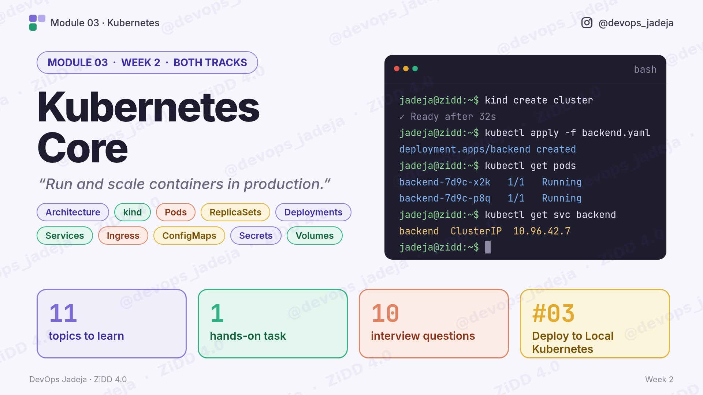
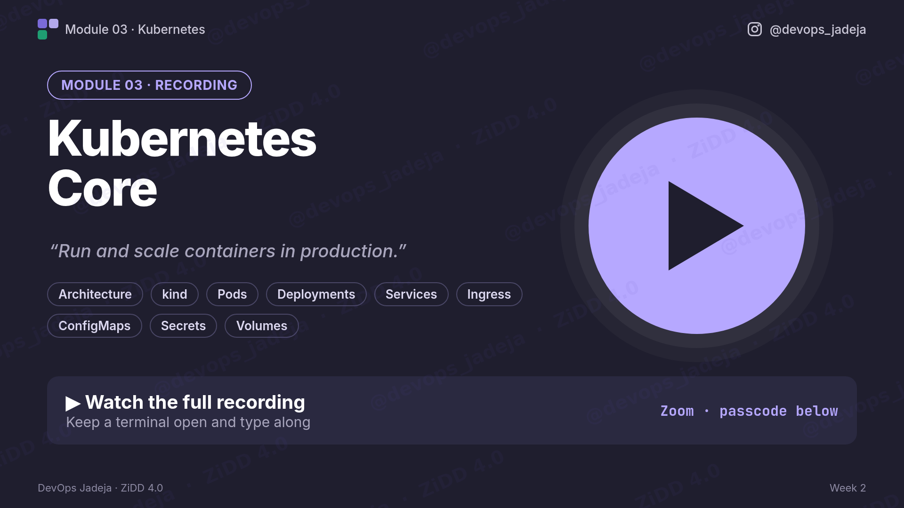
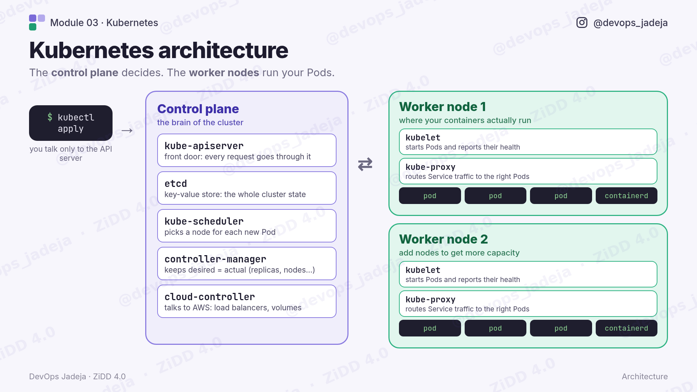
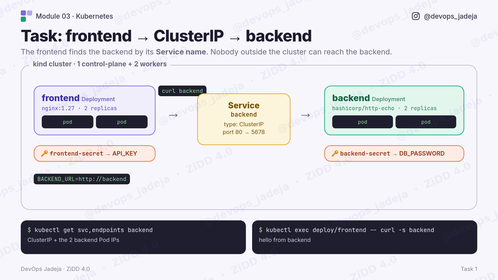

<p align="center">
  
</p>

# Module 03 · Kubernetes Core

> *"Run and scale containers in production."*

| | |
|---|---|
| **Week** | 2 |
| **Track** | Both tracks |
| **Tools** | Kubernetes, kind, kubectl |
| **Project** | #03 Deploy to Local Kubernetes |
| **Interview prep** | 10 Kubernetes interview questions (below) |

Docker runs containers on **one** machine. Kubernetes runs them across **many** machines and keeps them alive: it restarts crashed containers, spreads traffic, scales up and down, and rolls out new versions with no downtime. Everything in Amazon EKS (Module 05) builds on this module.

---

## Step 1 · Watch the recording

Watch the full Kubernetes session first. Keep a terminal open next to the video and type along.

[](https://us06web.zoom.us/rec/share/-ce4uTD4fXeD-1AtxLqh-R0rKnzpjgqU65un4yPsVyp4dDcRXPykRTrYLuHewLz1.yW9W1C7_3YOFwGiH)

▶️ **[Watch the Kubernetes recording on Zoom](https://us06web.zoom.us/rec/share/-ce4uTD4fXeD-1AtxLqh-R0rKnzpjgqU65un4yPsVyp4dDcRXPykRTrYLuHewLz1.yW9W1C7_3YOFwGiH)**

🔑 **Passcode:** `+29E6*Cb`

### 📂 Source code used in the video

All the manifest files used in the recording are in their own repo: **[github.com/jadeja-rajpal/kubernetes-zidd3](https://github.com/jadeja-rajpal/kubernetes-zidd3)**

| Folder / file | What it shows |
|---|---|
| `cluster-setup/kind-multinode.yaml` | A local kind cluster: 1 control-plane + 2 workers |
| `workloads/pod.yaml` | Your first Pod |
| `workloads/replicaset.yaml` | A ReplicaSet keeping several copies alive |
| `workloads/deployment.yaml` | A Deployment (rolling updates and rollbacks) |
| `workloads/service-clusterip.yaml`, `service-nodeport.yaml`, `loadbalancer.yaml` | The three Service types |
| `workloads/ingress.yaml` | Routing HTTP traffic with an Ingress |
| `workloads/configmap.yaml`, `deployment-with-configmap.yaml` | Settings kept outside the image |
| `workloads/secret.yaml`, `deployment-with-secret.yaml` | Passwords and keys |
| `workloads/empty-dir.yaml`, `host-volume.yaml`, `k8s-pvc.yaml` | Volume types |

Clone it and follow along with the video:
```bash
git clone https://github.com/jadeja-rajpal/kubernetes-zidd3.git
cd kubernetes-zidd3
```

> The rest of that repo (Helm `demo-app`, taints and tolerations, monitoring, autoscaling) is advanced material for **Chapter 2**, which we cover on Amazon EKS in [Module 05](../05-eks-microservices/README.md).

### What you will learn

Tick these off as you go.

- [ ] **Introduction to Kubernetes:** what a container orchestrator is
- [ ] **Why Kubernetes:** self-healing, scaling, rolling updates, service discovery, and the limits of plain Docker
- [ ] **Architecture:** the control plane (API server, etcd, scheduler, controller manager) and worker nodes (kubelet, kube-proxy, container runtime)
- [ ] **Installation:** a local multi-node cluster with **kind**, and talking to it with `kubectl`
- [ ] **Pods:** running a container in a Pod, and why a Pod alone is not enough
- [ ] **ReplicaSets:** keeping N copies alive, and how labels and selectors connect things
- [ ] **Deployments:** writing a Deployment file, scaling, rolling updates and rollbacks
- [ ] **Services:** ClusterIP, NodePort and LoadBalancer, with an example of each
- [ ] **Ingress:** what an Ingress controller is, and routing HTTP traffic by path or host
- [ ] **ConfigMaps and Secrets:** passing settings and passwords to Pods as env variables or files
- [ ] **Volumes:** `emptyDir`, `hostPath`, and PersistentVolumes with PersistentVolumeClaims

**Key concepts at a glance:** Architecture · kind · Pods · ReplicaSets · Deployments · Services · Ingress · ConfigMaps · Secrets · Volumes

> **Chapter 2 · Advanced Kubernetes** (autoscaling, Helm, taints and tolerations, node selectors, monitoring and more) is covered on real AWS infrastructure in **[Module 05: Amazon EKS & Microservices](../05-eks-microservices/README.md)**.

---

## 🖼️ Visual cheat sheet

### Kubernetes architecture


---

## 🛠️ Step 2 · Hands-on task

### Task 1 · Frontend talks to backend through a ClusterIP Service

**The goal:** build a local Kubernetes cluster, deploy a **frontend** and a **backend**, each with its own **Secret**, and prove that the frontend reaches the backend **by name** through a **ClusterIP** Service.



You need **Docker**, **[kind](https://kind.sigs.k8s.io/docs/user/quick-start/#installation)** and **[kubectl](https://kubernetes.io/docs/tasks/tools/)** installed.

**Requirements**
1. **Cluster:** create a kind cluster with **1 control-plane and 2 workers**, using `cluster-setup/kind-multinode.yaml` from the [source code repo](https://github.com/jadeja-rajpal/kubernetes-zidd3). All 3 nodes must be `Ready`.
2. **Backend Secret:** a Secret called `backend-secret` with a key `DB_PASSWORD`.
3. **Backend Deployment:** called `backend`, **2 replicas**, image `hashicorp/http-echo:1.0`, replying `hello from backend` on port `5678`. It gets `DB_PASSWORD` from `backend-secret` as an env variable.
4. **Backend Service:** called `backend`, type **ClusterIP**, port `80` → container port `5678`.
5. **Frontend Secret:** a Secret called `frontend-secret` with a key `API_KEY`.
6. **Frontend Deployment:** called `frontend`, **2 replicas**, image `nginx:1.27`. It gets `API_KEY` from `frontend-secret`, plus a normal env variable `BACKEND_URL=http://backend`.
7. **The proof:** from inside a frontend Pod, `curl http://backend` returns `hello from backend`.
8. **Keep the backend private:** no NodePort or LoadBalancer for the backend.

Write your YAML yourself, one file per object, in a folder like `task-1/`. Apply it with `kubectl apply -f task-1/`.

<details>
<summary>💡 Hints (try first, then open)</summary>

Create the cluster and check the nodes:
```bash
kind create cluster --name zidd --config cluster-setup/kind-multinode.yaml
kubectl get nodes
```

A Secret, written as YAML. `stringData` lets you write plain text, and Kubernetes stores it base64-encoded:
```yaml
# ZiDD 4.0 · DevOps Jadeja (@devops_jadeja) · github.com/jadeja-rajpal
apiVersion: v1
kind: Secret
metadata:
  name: backend-secret
type: Opaque
stringData:
  DB_PASSWORD: "change-me-123"
```

The backend Deployment and its Service:
```yaml
# ZiDD 4.0 · DevOps Jadeja (@devops_jadeja) · github.com/jadeja-rajpal
apiVersion: apps/v1
kind: Deployment
metadata:
  name: backend
spec:
  replicas: 2
  selector:
    matchLabels:
      app: backend
  template:
    metadata:
      labels:
        app: backend          # the Service finds Pods by this label
    spec:
      containers:
        - name: backend
          image: hashicorp/http-echo:1.0
          args: ["-text=hello from backend", "-listen=:5678"]
          ports:
            - containerPort: 5678
          env:
            - name: DB_PASSWORD
              valueFrom:
                secretKeyRef:
                  name: backend-secret
                  key: DB_PASSWORD
---
apiVersion: v1
kind: Service
metadata:
  name: backend               # this name becomes the DNS name: http://backend
spec:
  type: ClusterIP
  selector:
    app: backend
  ports:
    - port: 80
      targetPort: 5678
```

The frontend is the same pattern: a Deployment with `image: nginx:1.27`, `API_KEY` from `frontend-secret`, and a plain env variable:
```yaml
          env:
            - name: BACKEND_URL
              value: "http://backend"
```

Useful commands:
```bash
kubectl get pods -o wide                  # which node each Pod landed on
kubectl describe svc backend              # look at "Endpoints"
kubectl exec -it deploy/frontend -- bash  # open a shell inside a frontend Pod
```
</details>

**Check your work**

| Test | Command | Expected |
|---|---|---|
| 3 nodes are up | `kubectl get nodes` | 1 `control-plane` + 2 workers, all `Ready` |
| 4 Pods running | `kubectl get pods -o wide` | 2 `backend-…` + 2 `frontend-…`, `Running`, spread over the workers |
| Service is ClusterIP | `kubectl get svc backend` | `TYPE` is `ClusterIP`, no external IP |
| Service found the Pods | `kubectl get endpoints backend` | **2** Pod IPs ending in `:5678` |
| **Frontend → backend** | `kubectl exec deploy/frontend -- curl -s http://backend` | `hello from backend` ✅ |
| Full DNS name works too | `kubectl exec deploy/frontend -- curl -s http://backend.default.svc.cluster.local` | `hello from backend` |
| Secret reached the backend | `kubectl describe pod -l app=backend \| grep DB_PASSWORD` | `DB_PASSWORD: <set to the key 'DB_PASSWORD' in secret 'backend-secret'>` (http-echo has no shell, so use `describe`, not `exec`) |
| Env reached the frontend | `kubectl exec deploy/frontend -- env \| grep -E 'BACKEND_URL\|API_KEY'` | both variables are there |
| Secrets are only encoded | `kubectl get secret backend-secret -o jsonpath='{.data.DB_PASSWORD}' \| base64 -d` | your password in plain text 😬 |

**Think about it:**
1. Delete one backend Pod with `kubectl delete pod <name>`. What happens, and who brought it back?
2. Scale the backend to 4 with `kubectl scale deploy backend --replicas=4`, then look at `kubectl get endpoints backend` again. What changed, and why didn't you have to touch the Service?
3. The last check decoded your Secret in one command. So what does a Secret actually protect you from?

**Bonus:** give the frontend its own ClusterIP Service, then open it in your browser with `kubectl port-forward svc/frontend 8080:80`.

Clean up when you're done: `kind delete cluster --name zidd`.

---

## 📦 Project #03 · Deploy to Local Kubernetes

> *Deploy a multi-tier app on a local cluster with Services, Ingress, ConfigMaps and health probes.*

Task 1 is the base of this project. Its frontend → ClusterIP → backend setup, with Secrets, is the core of every multi-tier app on Kubernetes.

---

## 🎤 Step 3 · Interview questions

Answer each one **out loud** before you open the hint. Interviewers want to hear how you think and which commands you reach for.

### Q1. Why do we need Kubernetes if we already have Docker?
<details>
<summary>What a good answer covers</summary>

- Docker runs containers on **one machine**. It does not decide **where** to run them across many machines, or what to do when a machine dies.
- Kubernetes is a **container orchestrator**. It gives you:
  - **Self-healing:** a crashed container is restarted, and Pods on a dead node are recreated elsewhere.
  - **Scaling:** `kubectl scale` or autoscaling on CPU.
  - **Service discovery and load balancing:** a stable name and IP in front of changing Pods.
  - **Rolling updates and rollbacks** with no downtime.
  - **Declarative config:** you describe the **desired state** in YAML, and Kubernetes keeps reality matching it.
- Kubernetes does **not** replace Docker images. It still runs the same container images, through a runtime like containerd.
</details>

### Q2. Explain the Kubernetes architecture.
<details>
<summary>What a good answer covers</summary>

**Control plane** (the brain):
- **kube-apiserver:** the front door. `kubectl` and every component talk only to it.
- **etcd:** a key-value store holding the whole cluster state. Back it up.
- **kube-scheduler:** picks a node for each new Pod, based on resources, labels and taints.
- **kube-controller-manager:** runs control loops that keep the actual state equal to the desired state (ReplicaSets, nodes, endpoints).
- **cloud-controller-manager:** talks to the cloud (load balancers, volumes) on EKS.

**Worker nodes** (the muscle):
- **kubelet:** starts the Pods assigned to its node and reports their health.
- **kube-proxy:** sets up the networking rules that send Service traffic to Pods.
- **Container runtime:** containerd actually runs the containers.

Bonus: walk through `kubectl apply -f deployment.yaml`. API server → stored in etcd → Deployment controller creates a ReplicaSet → ReplicaSet controller creates Pods → scheduler assigns nodes → kubelet starts the containers.
</details>

### Q3. What is a Pod, and why doesn't Kubernetes run containers directly?
<details>
<summary>What a good answer covers</summary>

- A **Pod** is the smallest unit Kubernetes runs: one or more containers that **share the same network** (one IP, talk over `localhost`) and can **share volumes**.
- Most Pods have one container. Extra "sidecar" containers are for helpers like log shippers or proxies.
- Pods are **disposable**: if one dies, it is not repaired, it is **replaced** by a new Pod with a new IP. That is why you never create bare Pods in production. You use a Deployment, and put a Service in front.
</details>

### Q4. What is the difference between a ReplicaSet and a Deployment?
<details>
<summary>What a good answer covers</summary>

- A **ReplicaSet** keeps N identical Pods running, using a **label selector** to know which Pods it owns.
- A **Deployment** manages ReplicaSets for you. When you change the image, it creates a **new ReplicaSet** and shifts Pods over gradually: a **rolling update**, controlled by `maxSurge` and `maxUnavailable`.
- The old ReplicaSet is kept (scaled to 0), so you can **roll back**: `kubectl rollout undo deploy/web`. Check progress with `kubectl rollout status` and `kubectl rollout history`.
- In practice: always use Deployments. You rarely create a ReplicaSet yourself.
</details>

### Q5. Explain the Service types: ClusterIP, NodePort and LoadBalancer.
<details>
<summary>What a good answer covers</summary>

- A **Service** gives a set of Pods (chosen by labels) a **stable name and IP**, and load-balances across them.
- **ClusterIP** (default): reachable **only inside** the cluster. Used for backends and databases.
- **NodePort:** opens the same port (30000–32767) on **every node**: `<NodeIP>:<NodePort>`. Good for testing, rarely used in production.
- **LoadBalancer:** asks the **cloud** for a real load balancer (on AWS, an ELB) with a public address. On kind it stays `<pending>` because there is no cloud.
- Each type builds on the one before it: a LoadBalancer also gets a NodePort and a ClusterIP.
- Also good to know: **ExternalName** (a DNS alias) and **headless** Services (`clusterIP: None`).
</details>

### Q6. How does the frontend find the backend inside the cluster?
<details>
<summary>What a good answer covers</summary>

- Through **DNS**. CoreDNS gives every Service a name: `backend`, or in full `backend.<namespace>.svc.cluster.local`.
- The name resolves to the Service's **ClusterIP**, which never changes, even though the Pods behind it come and go.
- The Service's **selector** (`app: backend`) picks the Pods. Kubernetes keeps the list of their IPs in **Endpoints** (EndpointSlices).
- **kube-proxy** on each node sends traffic for the ClusterIP to one of those Pod IPs.
- Debug it with `kubectl get endpoints backend`. If the list is empty, the selector and the Pod labels don't match. That is the most common mistake.
</details>

### Q7. What is an Ingress, and how is it different from a LoadBalancer Service?
<details>
<summary>What a good answer covers</summary>

- A **LoadBalancer Service** gives **one** cloud load balancer per Service. Ten services means ten load balancers, which is expensive.
- An **Ingress** is a set of HTTP routing rules: **one entry point**, routed by **host** (`api.example.com`) or **path** (`/api`, `/app`) to different Services. It can also handle TLS.
- An Ingress does nothing on its own: you need an **Ingress controller** running in the cluster to apply the rules (for example ingress-nginx, Traefik, or the AWS Load Balancer Controller on EKS).
- The newer **Gateway API** is the successor to Ingress, with more features.
</details>

### Q8. ConfigMap vs Secret: what is the difference, and is a Secret secure?
<details>
<summary>What a good answer covers</summary>

- Both pass settings to Pods without baking them into the image, as **env variables** or as **files** (volumes).
- **ConfigMap:** non-sensitive settings (URLs, feature flags, config files).
- **Secret:** sensitive values (passwords, tokens, keys). They are **base64-encoded, not encrypted**. Anyone who can read the Secret can decode it in one command.
- To really protect them: limit access with **RBAC**, turn on **encryption at rest** for etcd, and use an external store like **AWS Secrets Manager** with the External Secrets Operator or the Secrets Store CSI driver. Never commit Secrets to Git.
- Env variables are read **once at start**: change the Secret and you must restart the Pods. Mounted files are updated after a short delay.
</details>

### Q9. Explain the volume types: emptyDir, hostPath, PV and PVC.
<details>
<summary>What a good answer covers</summary>

- **emptyDir:** an empty folder created with the Pod and **deleted with it**. Used to share files between containers in one Pod, or as scratch space.
- **hostPath:** mounts a folder from the **node** into the Pod. The data is tied to that one node, and it is a security risk. Avoid it except for system tools.
- **PersistentVolume (PV):** a piece of real storage in the cluster (on AWS, an EBS volume).
- **PersistentVolumeClaim (PVC):** a Pod's **request** for storage ("1Gi, ReadWriteOnce"). Kubernetes binds the claim to a PV.
- **StorageClass:** creates PVs **automatically** when a PVC asks (dynamic provisioning).
- Data in a PV **survives** the Pod being deleted. That is what you use for databases.
</details>

### Q10. A Pod is in `CrashLoopBackOff`. How do you debug it?
<details>
<summary>What a good answer covers</summary>

1. `kubectl get pods`: look at the status and the **RESTARTS** count.
2. `kubectl describe pod <name>`: read **Events** at the bottom, the **Last State**, the exit code and the reason (`OOMKilled`, `Error`).
3. `kubectl logs <name>`, and `kubectl logs <name> --previous` for the container that **crashed**.
4. Common causes: the app crashes on start (a missing env var, ConfigMap or Secret), a wrong command, a **liveness probe** that kills a slow-starting app, or a memory **limit** that is too low (`OOMKilled`, exit code 137).
5. Related states: `ImagePullBackOff` (wrong image name or no access to the registry), `Pending` (no node has enough CPU or memory, or the PVC is not bound).
</details>

---

## 🧰 Command cheat sheet

| Topic | Commands to know |
|---|---|
| kind | `kind create cluster --name zidd --config kind.yaml`, `kind get clusters`, `kind delete cluster --name zidd` |
| Cluster | `kubectl cluster-info`, `kubectl get nodes -o wide`, `kubectl config get-contexts` |
| Apply | `kubectl apply -f file.yaml`, `kubectl apply -f folder/`, `kubectl delete -f file.yaml` |
| Look | `kubectl get pods,deploy,rs,svc,ingress`, `-o wide`, `-o yaml`, `-l app=backend`, `-A` |
| Debug | `kubectl describe pod <name>`, `kubectl logs -f <pod>`, `--previous`, `kubectl exec -it <pod> -- sh`, `kubectl get events --sort-by=.lastTimestamp` |
| Deployments | `kubectl scale deploy x --replicas=4`, `kubectl set image deploy/x c=img:v2`, `kubectl rollout status/history/undo deploy/x` |
| Services | `kubectl get endpoints x`, `kubectl port-forward svc/x 8080:80` |
| Config | `kubectl create configmap x --from-literal=K=V`, `kubectl create secret generic x --from-literal=K=V` |
| Storage | `kubectl get pv,pvc,storageclass` |
| Help | `kubectl explain deployment.spec`, `kubectl api-resources` |

---

## ✅ Check yourself

By the end of the week you should be able to:

- [ ] Explain why Kubernetes exists, in two sentences
- [ ] Draw the architecture and say what each component does
- [ ] Create a multi-node kind cluster and point `kubectl` at it
- [ ] Write a Deployment from memory and explain how labels connect it to a Service
- [ ] Do a rolling update and a rollback
- [ ] Choose between ClusterIP, NodePort, LoadBalancer and Ingress for a given need
- [ ] Pass settings with a ConfigMap and a password with a Secret
- [ ] Explain emptyDir vs a PVC, and when you need each
- [ ] Debug a Pod stuck in `CrashLoopBackOff`, `ImagePullBackOff` or `Pending`

Stuck on something? Write down the command, what you expected and what you got. Bring it to the **Saturday or Sunday live doubt session**.

---

⬅️ [Module 02: Docker: Containers from Scratch](../02-docker/README.md) &nbsp;·&nbsp; [Module 04: AWS Cloud Foundations](../04-aws-cloud-foundations/README.md) ➡️

[Back to all modules](../../README.md)

---

<p align="center"><sub>© 2026 <b>DevOps Jadeja</b> (<a href="https://www.instagram.com/devops_jadeja/">@devops_jadeja</a>) · ZiDD 4.0<br>All content, images and code in this repo are for enrolled ZiDD 4.0 students only. Do not copy, resell or republish without written permission. See <a href="../../LICENSE">LICENSE</a>.</sub></p>
